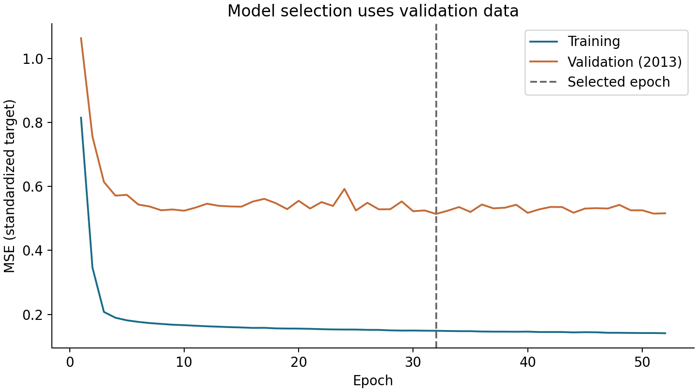
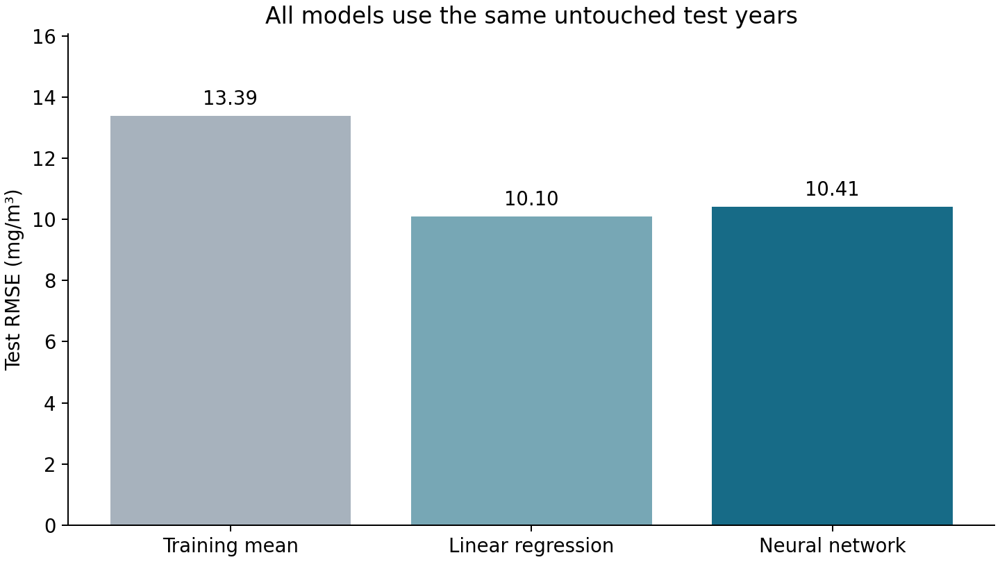
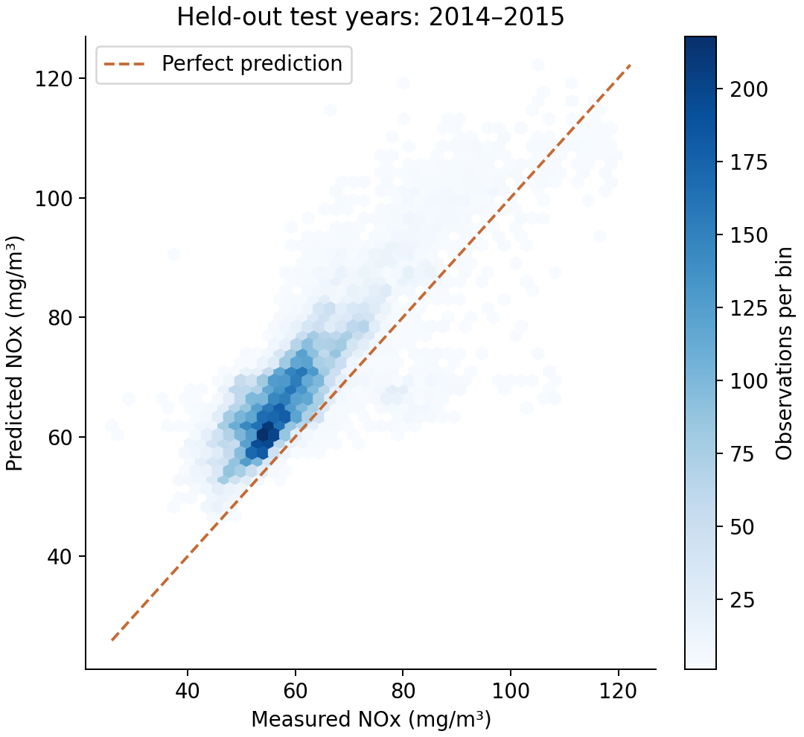

# Turbine NOx Lab

A small PyTorch regression project that estimates **same-hour NOx concentration** from nine gas-turbine measurements. It includes original data, a hand-written training loop, committed model weights, a Streamlit demo, and a seven-slide presentation.

## Quick start

Use Python **3.11–3.13**. This project was trained and checked on Windows with Python 3.13.15 and CPU PyTorch 2.9.1. A GPU is unnecessary.

From this project directory, in PowerShell:

```powershell
python -m venv .venv
.\.venv\Scripts\python.exe -m pip install torch==2.9.1 --index-url https://download.pytorch.org/whl/cpu
.\.venv\Scripts\python.exe -m pip install -r requirements.txt
.\.venv\Scripts\python.exe -m streamlit run app.py
```

Open the local URL printed by Streamlit, normally http://localhost:8501. After installation, you can also double-click `launch_demo.bat`. The original data and trained checkpoint are included, so the app needs **no download or retraining**. It runs offline after package installation.

On macOS/Linux, use `python3 -m venv .venv`, then `.venv/bin/python -m pip install -r requirements.txt` and `.venv/bin/python -m streamlit run app.py`.

## Problem and real data

The task estimates NOx, a measured emission concentration in **mg/m³**, using operating and ambient sensors. This is regression on tabular hourly aggregates, rather than financial-news sentiment or image classification. It is an educational estimate, not a plant control system.

Source: [UCI Gas Turbine CO and NOx Emission Data Set](https://archive.ics.uci.edu/dataset/551/gas+turbine+co+and+nox+emission+data+set), [DOI: 10.24432/C5WC95](https://doi.org/10.24432/C5WC95), CC BY 4.0. The observations come from one turbine in Turkey. All **36,733 examples** in the five original yearly CSVs are used. See [data provenance](data/README.md) for attribution, checksums, and source caveats.

| Split | Years | Examples | Purpose |
| --- | --- | ---: | --- |
| Training | 2011–2012 | 15,039 | Learn parameters and preprocessing statistics |
| Validation | 2013 | 7,152 | Select learning rate and checkpoint epoch |
| Test | 2014–2015 | 14,542 | Final evaluation after selection |

The split respects chronological order and reserves the last two years for testing, as the source requests. It uses a separate validation year instead of the source paper's cross-validation. A random row split could put closely related hours into training and test. Individual timestamps are unavailable, so a precise gap between splits cannot be checked.

The nine input columns, in saved model order, are:

```text
AT,AP,AH,AFDP,GTEP,TIT,TAT,TEY,CDP
```

They describe ambient temperature, pressure and humidity, filter pressure difference, exhaust pressure, inlet and after temperatures, energy yield, and compressor discharge pressure. The other emission measurement, CO, is excluded. NOX is the sole target. Year and source-row identifiers are excluded. No missing values are imputed. Loading checks row counts, file hashes, and finite values.

## Model and validation choices

The network starts from random weights. Its layers are `Linear(9, 32)`, `ReLU`, `Linear(32, 16)`, `ReLU`, and `Linear(16, 1)`: **865 trainable parameters**. The final output has no activation because it is a continuous concentration estimate.

`train.py` implements batch loading, gradient clearing, forward passes, MSE loss, backpropagation, Adam updates, validation, and checkpoint selection directly in PyTorch. No pre-trained model or scikit-learn estimator is used. Input and target standardization use **training statistics only**. Inference converts the target back to mg/m³.

Fixed choices: seed 42, batch size 256, weight decay 0.0001, maximum 120 epochs, and early-stopping patience 20. Two learning rates use the same initialization and batch-order seed:

| Learning rate | Best epoch | Epochs run | Validation RMSE (mg/m³) |
| ---: | ---: | ---: | ---: |
| 0.001 | **32** | 52 | **7.507** |
| 0.0003 | 53 | 73 | 7.618 |

The smallest validation RMSE selects the first trial's epoch-32 weights. Training took approximately **34 seconds** on the available CPU, excluding package installation and startup. The architecture and other fixed settings are modest choices, not an exhaustive search. `train.py` never loads 2014 or 2015. The model was not retuned after seeing the test results.



Training loss averages batches while weights change during an epoch. Validation loss uses the weights at the end of that epoch. Both curves use the standardized target.

## Final test results

All scores below use the **14,542 test examples from 2014–2015** and the frozen checkpoint. MAE and RMSE use mg/m³, and smaller is better. R² is dimensionless, with 1 indicating perfect predictions.

| Model | MAE | RMSE | R² |
| --- | ---: | ---: | ---: |
| Always predict training mean | 11.512 | 13.391 | -0.603 |
| Linear regression baseline | **7.431** | **10.102** | **0.088** |
| PyTorch neural network | 9.073 | 10.407 | 0.032 |

The network improves RMSE by **22.3%** over the training-mean baseline. **Linear regression has lower test MAE and RMSE than the network.** This experiment does not establish that a neural network is the best model for these data. The low R² also shows limited generalization across years. We report the stronger baseline rather than hiding that result.

The constant baseline learns the training target mean. The linear baseline fits ordinary least squares with an intercept on the same standardized training inputs using NumPy. It has no hidden layer and no tuned hyperparameters. Neither baseline adapts to the test years.

| Test year | Network MAE | Network RMSE | Network R² |
| --- | ---: | ---: | ---: |
| 2014 | 7.620 | 9.137 | 0.160 |
| 2015 | 10.480 | 11.506 | -0.068 |





Exact metrics, a checkpoint SHA-256, and every test prediction are saved in `artifacts/test_metrics.json` and `artifacts/test_predictions.csv`. Re-running evaluation reproduces those calculations. Repeated evaluation does not create a fresh unseen test set.

## Reproduce training and evaluation

Once dependencies are installed:

```powershell
# Optional: restore the unchanged original data directly from UCI.
.\.venv\Scripts\python.exe download_data.py

# Train using 2011–2012 and select using 2013 only.
.\.venv\Scripts\python.exe train.py

# Evaluate the saved selected model and regenerate reports/plots.
.\.venv\Scripts\python.exe evaluate.py

# Check split boundaries, checkpoint inference, metrics, and demo interaction.
.\.venv\Scripts\python.exe -m unittest discover -s tests -v
```

Downloading verifies a pinned archive hash before replacing files. Training overwrites the checkpoint and history files. Evaluation overwrites the test report and plots. Run evaluation after retraining so they describe the same checkpoint, and restart Streamlit to reload the new weights. The slides contain the submitted run's results and do not regenerate automatically. Bit-for-bit training reproducibility can vary across operating systems and PyTorch builds, although seeds and deterministic CPU algorithms are set.

The checkpoint stores the state dictionary, architecture, feature order, training scaler, training input ranges, baseline coefficients, and chosen epoch. It is roughly a few kilobytes, so ordinary Git is sufficient. **Keep `artifacts/model.pt` in the repository.**

## Demo

Choose one of eight recorded training examples, edit the nine values, and select **Estimate NOx**. The app displays the estimate and flags individual inputs outside the training range. A second tab accepts a CSV and returns downloadable predictions. Column order may differ, but the nine named columns must exist, contain numeric finite values, and include at most 10,000 rows. The results tab shows the saved final evaluation.

These presets are training inputs, so their predictions demonstrate the interface, not generalization. The app uses `st.cache_resource` to load the saved model, `model.eval()`, and `torch.inference_mode()`. It has no training loop or optimizer. The app test blocks optimizer construction, changes a measurement, checks the prediction updates, and verifies that the weights file remains unchanged.

## Repository guide

| File | Role |
| --- | --- |
| `download_data.py` | Retrieve the original UCI files and record provenance |
| `turbine/config.py` | Input schema, year split, paths, and source |
| `turbine/data.py` | Validate data and fit/apply training-only scaling |
| `turbine/model.py` | Small network architecture |
| `train.py` | Hand-written training loop and validation selection |
| `evaluate.py` | Frozen test metrics, predictions, and plots |
| `turbine/inference.py` | Load weights and predict without training |
| `app.py` | Streamlit input and results interface |
| `tests/test_project.py` | Five substantive data/inference/demo checks |
| `artifacts/` | Committed trained model, histories, metrics, and plots |
| `slides/turbine_nox.pptx` | Seven-slide presentation with editable charts |
| `docs/EXPLAIN_THE_MODEL.md` | Explanation for studying before the defence |

## Limitations and next experiments

- One turbine and an older period limit generalization to other equipment and years. Test scores deteriorate in 2015. Temporal drift is a possible explanation, not a demonstrated cause.
- Consecutive hours can be correlated. Tests rule out exact repeated rows across splits, but cannot establish independence or check missing timestamps.
- R² is low on the final test set, and the linear baseline performs better. The network is a small educational experiment rather than a deployment-ready estimator.
- Range checks detect some extrapolation but cannot guarantee a physically realistic combination of inputs. The unconstrained output can be negative and the app flags that case. Predictions have no calibrated uncertainty interval.
- The UCI summary labels CDP as mbar despite a scale around 10–15. The model preserves the original values, and the app uses the label “source units.”
- This is same-hour estimation using concurrently measured sensors, not future forecasting. Editing a sensor value does not demonstrate a causal effect or a safe operating intervention.

Future work could test a smaller network or stronger regularization using validation data, then reserve a new, untouched period for a final comparison. Do not keep changing the submitted model to improve this already-observed test score.

## Presentation and authorship

Open `slides/turbine_nox.pptx`. Its seven slides cover the task, data and split, model, training, baseline comparison, test errors, and the demo/limitations. Allow about seven minutes for slides and three for the demo.

AI assisted in scaffolding, documentation, and checks. The project uses a small original implementation rather than a copied tutorial. Before submitting, understand and be able to explain every code line and reproduce the results. Use the explanation document to study in advance. During the defence, close the assistant and study materials and follow the restriction to slides, code, and demo only.

The topic must also be distinct from classmates' presentations. Confirm that **gas-turbine NOx estimation** meets that classroom-specific condition before submitting.

## GitHub submission

Publish these files to your GitHub repository, including the data, weights, reports, and slide deck. `.gitignore` excludes the local virtual environment and private slide build files. Verify the repository from a fresh clone using the quick-start commands. Send the repository URL yourself before **Friday 30 October 2026, 12:00 Paris time**. If private, grant the instructor access before the cutoff. The defence is **15:30–16:00** the same day.
